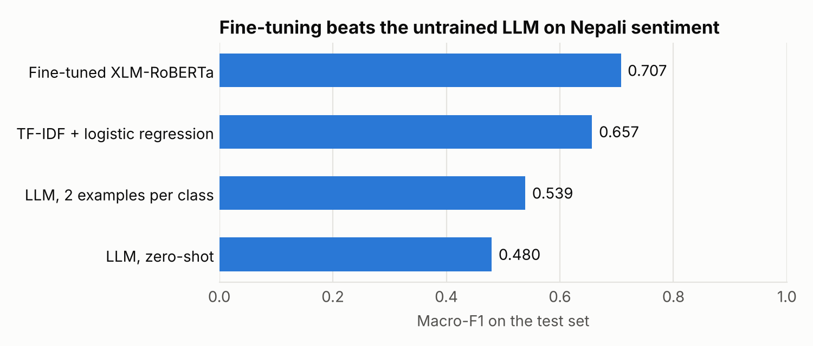
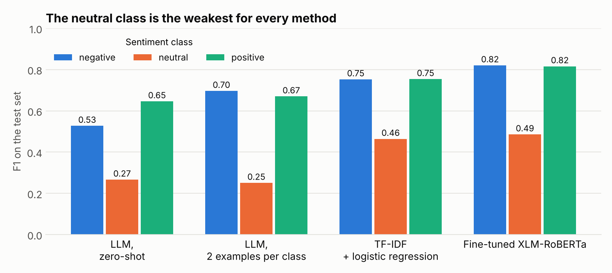
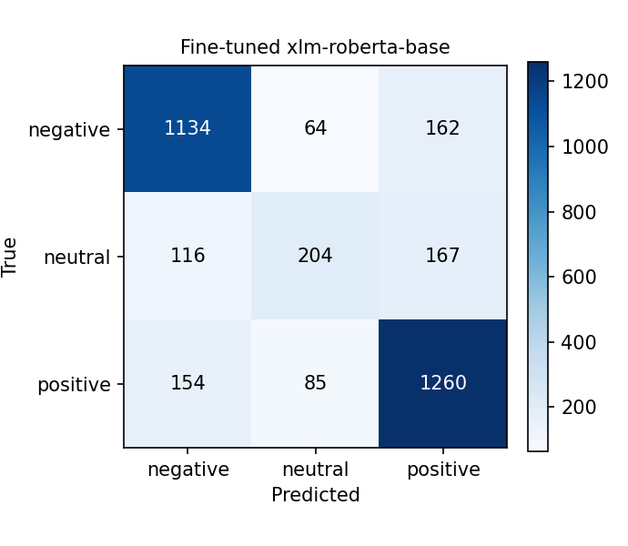
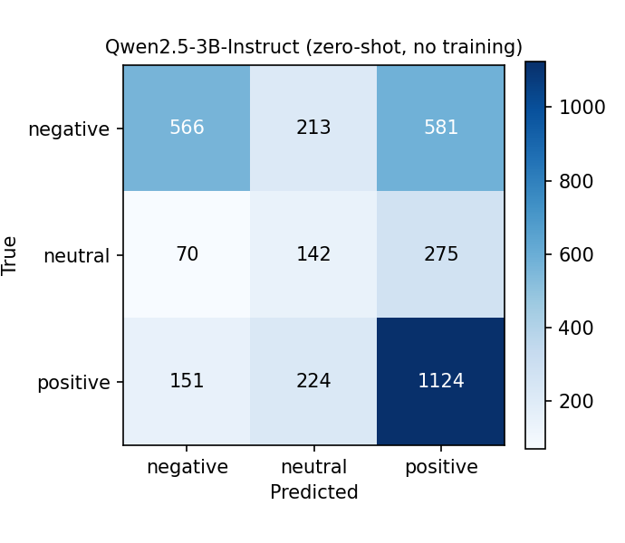
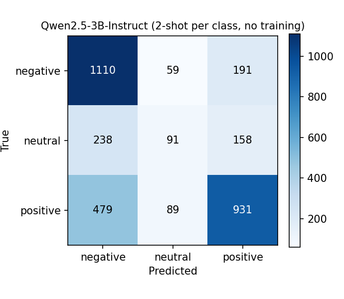

# Fine-tuning vs. zero-shot LLMs for Nepali sentiment analysis

Is it still worth fine-tuning a small multilingual model for a low-resource language, or can a general-purpose large language model do the job with no training at all?

**Paper:** [Is fine-tuning still worth it for a low-resource language? (PDF)](paper/Dahal_2026_nepali_sentiment_finetune_vs_llm.pdf), also on [my website](https://subarna007.github.io/personalwebsite/#nepali).

This project answers that question for **Nepali**, on a public benchmark of 33.5k COVID-19 tweets labelled positive, neutral or negative. Three approaches are evaluated on exactly the same held-out test set:

| Approach | Model | Labelled data it uses |
|---|---|---|
| Classical baseline | Character n-gram TF-IDF + logistic regression | Full training split |
| Fine-tuned transformer | XLM-RoBERTa base (278M parameters) | Full training split |
| Instruction-tuned LLM | Qwen2.5-3B-Instruct, zero-shot and few-shot | None, or 2 examples per class in the prompt |

## Results

<!-- RESULTS:START -->
| Method | Labelled examples used | Accuracy | Macro-F1 | F1 negative | F1 neutral | F1 positive | Test size |
|---|---|---|---|---|---|---|---|
| TF-IDF (char 1-4 grams) + Logistic Regression | 26,764 | 0.7029 | 0.6568 | 0.7527 | 0.4639 | 0.7538 | 3,346 |
| Qwen2.5-3B-Instruct (zero-shot, no training) | 0 | 0.5475 | 0.4799 | 0.5272 | 0.2664 | 0.6462 | 3,346 |
| Qwen2.5-3B-Instruct (2-shot per class, no training) | 6 | 0.6372 | 0.5391 | 0.6966 | 0.2507 | 0.6700 | 3,346 |
| Fine-tuned xlm-roberta-base | 26,764 | 0.7764 | 0.7074 | 0.8205 | 0.4857 | 0.8161 | 3,346 |
<!-- RESULTS:END -->

Macro-F1 is the main metric because the classes are not balanced. Results are from a single run (seed 42) on a Kaggle T4 GPU.

### Uncertainty and significance

95% intervals from 2,000 bootstrap resamples of the test set; McNemar's test on the tweets each method gets right.

| Method | Macro-F1 (95% CI) |
|---|---|
| TF-IDF + logistic regression | 0.657 (0.640-0.675) |
| Qwen2.5-3B, zero-shot | 0.480 (0.462-0.498) |
| Qwen2.5-3B, 2 per class | 0.539 (0.520-0.557) |
| Fine-tuned XLM-RoBERTa | 0.707 (0.688-0.725) |

| Comparison | Difference in macro-F1 (95% CI) | McNemar p |
|---|---|---|
| XLM-R vs TF-IDF | 0.051 (0.030-0.072) | 4e-19 |
| TF-IDF vs LLM 2-shot | 0.118 (0.096-0.141) | 9e-12 |
| LLM 2-shot vs LLM zero-shot | 0.059 (0.040-0.078) | 2e-21 |

All methods get worse on longer tweets: the fine-tuned model goes from 0.79 macro-F1 on tweets of up to 10 words to 0.60 on tweets over 40 words.

### Findings

- **Fine-tuning is still clearly ahead.** Fine-tuned XLM-RoBERTa reaches 0.707 macro-F1, against 0.480 for the 3B-parameter LLM used zero-shot.
- **A simple baseline beats the untrained LLM.** Character TF-IDF with logistic regression (0.657 macro-F1) outperforms the LLM in both the zero-shot and the few-shot setting.
- **Six examples help the LLM, but unevenly.** Adding two examples per class lifts accuracy from 0.548 to 0.637, almost entirely through the negative class; neutral F1 does not improve (0.266 to 0.251).
- **Neutral is the hard class for every method.** No approach exceeds 0.49 F1 on neutral tweets, which suggests the boundary between neutral and the other two classes is ambiguous in the labels themselves.





### Error patterns

| Fine-tuned XLM-RoBERTa | LLM, zero-shot | LLM, 2 examples per class |
|---|---|---|
|  |  |  |

The confusion matrices show that the LLM's errors are biased rather than random. Zero-shot, it labels 581 of 1,360 negative tweets as positive. With six examples in the prompt the bias flips: negative recall rises to 1,110 of 1,360, but 479 of 1,499 positive tweets are now labelled negative. The LLM always returned a valid label, so none of its errors come from unparseable output. Fine-tuning took about 13 minutes on one T4 GPU.

All metrics (JSON), confusion matrices and per-tweet predictions are in `results/`.

## Dataset

**NepCOV19Tweets** (Sitaula et al., 2021): Nepali-language tweets about COVID-19 with three sentiment classes. It is loaded from the Hugging Face Hub as [`raygx/NepCov19Tweets`](https://huggingface.co/datasets/raygx/NepCov19Tweets).

Preparation, in `src/common.py`:

1. Whitespace is normalised and empty rows are removed.
2. Exact duplicate tweets are removed **before** splitting, so no tweet can appear in both the training and the test set.
3. The data is split 80 / 10 / 10 into train / validation / test, stratified by class, with a fixed seed (42).

Because of step 2 and the custom split, the numbers here are not directly comparable with those in the original paper.

## Methods

**TF-IDF + logistic regression** (`src/baseline_tfidf.py`). Character 1-4 grams, which avoid the need for a Nepali tokeniser or stemmer. The regularisation strength is chosen on the validation set.

**Fine-tuned XLM-RoBERTa** (`src/train_transformer.py`). All weights are fine-tuned for 4 epochs with AdamW (learning rate 2e-5, weight decay 0.01), a linear schedule with 6% warm-up, batch size 32, maximum length 128 tokens, gradient clipping and mixed precision. The epoch with the best validation macro-F1 is kept, and the test set is evaluated once.

**Zero-shot and few-shot LLM** (`src/zero_shot_llm.py`). The model receives an English instruction and the Nepali tweet, and must answer with one word. Decoding is greedy. In the few-shot setting, 2 labelled tweets per class from the training split are added to the prompt. Any output that cannot be mapped to a label is counted as an error and the rate is reported.

## Reproducing the results

The full pipeline takes roughly one hour on a single free Kaggle or Colab T4 GPU.

```bash
git clone https://github.com/subarna007/nepali-sentiment-finetune-vs-llm.git
cd nepali-sentiment-finetune-vs-llm
pip install -r requirements.txt
bash run_all.sh
```

Or run the steps one at a time:

```bash
python src/baseline_tfidf.py                       # CPU, about a minute
python src/train_transformer.py                    # GPU
python src/zero_shot_llm.py --shots 0              # GPU
python src/zero_shot_llm.py --shots 2              # GPU
python src/make_report.py                          # builds the results table
python src/make_figures.py                         # builds the summary figures
```

`notebooks/experiments.ipynb` runs the same steps in a notebook. Useful options: `--model` to try another encoder or LLM, `--class_weights` for a class-weighted loss, and `--max_samples` to evaluate the LLM on a smaller stratified subset.

## Repository layout

```
src/common.py             data loading, fixed splits, metrics, result saving
src/baseline_tfidf.py     classical baseline
src/train_transformer.py  XLM-RoBERTa fine-tuning
src/zero_shot_llm.py      zero-shot / few-shot LLM evaluation
src/make_report.py        results table for README and results/results.md
src/make_figures.py       summary figures
paper/                    the write-up (LaTeX source and PDF)
notebooks/                notebook version of the full run
results/                  metrics (JSON), confusion matrices, predictions
```

## What could be explored next

- Larger open LLMs (7B-70B) and Nepali-specific encoders such as NepBERTa.
- Instructions written in Nepali instead of English, and more or better-chosen examples.
- LoRA fine-tuning of the same 3B LLM, to separate model size from training.
- Learning curves (100, 500, 2,000 labels) to find where fine-tuning overtakes the LLM.
- Re-annotating neutral tweets with several people to measure label agreement.

## Limitations

- One dataset, one domain (COVID-19 tweets) and one random seed; differences of a point or less should not be treated as meaningful.
- Only one open LLM is tested, with one prompt. Larger or proprietary models may behave differently.
- Sentiment labels on tweets are subjective, so the labels themselves contain noise.

## References

- C. Sitaula, A. Basnet, A. Mainali, T. B. Shahi. "Deep Learning-Based Methods for Sentiment Analysis on Nepali COVID-19-Related Tweets." *Computational Intelligence and Neuroscience*, 2021. https://doi.org/10.1155/2021/2158184
- A. Conneau et al. "Unsupervised Cross-lingual Representation Learning at Scale." *ACL*, 2020.

## Author

**Subarna Dahal**, MSc Information Technology (AI and ML). [github.com/subarna007](https://github.com/subarna007)

The dataset belongs to its original authors; see the dataset card for its terms.
